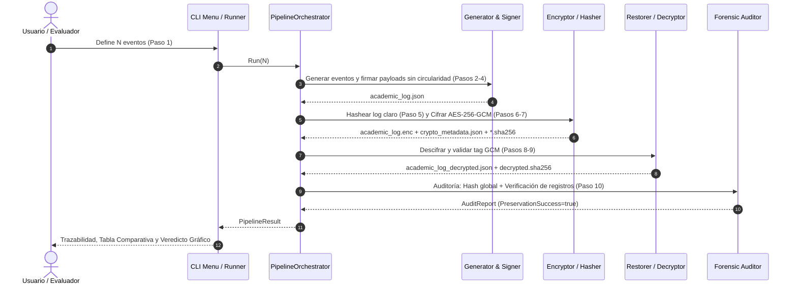

# Estructura y Contenido de Diapositivas para Sustentación
## Proyecto: Protección de Logs Estructurados en Reposo (Taller 2 – Criptografía)

> **Documento de Diseño y Contenido para Diapositivas (Entregable 2 - PDF)**  
> **Formato de exportación sugerido:** Presentación 16:9 (Canva / PowerPoint / Google Slides) exportada a `.PDF`.

---

## Índice General de Diapositivas

1. **Slide 1:** Portada Institucional y Ficha Técnica
2. **Slide 2:** Planteamiento del Problema y Contexto de Negocio
3. **Slide 3:** Atributos de Seguridad y Modelo de Amenazas
4. **Slide 4:** Arquitectura del Log y Esquema Estructurado JSON
5. **Slide 5:** Desacoplamiento Criptográfico y Prevención de Circularidad (Paso 3)
6. **Slide 6:** Primitivas Criptográficas: SHA-256 Nativo y Streaming O(1)
7. **Slide 7:** Cifrado en Reposo: AES-256-GCM y Gestión de Llaves (NIST SP 800-38D / 800-57)
8. **Slide 8:** Diagrama de Diseño 1: Arquitectura Estructural del Sistema
9. **Slide 9:** Diagrama de Diseño 2: Comportamiento Secuencial del Pipeline (Pasos 1 al 10)
10. **Slide 10:** Auditoría Forense y Comparación en Tiempo Constante (Paso 10)
11. **Slide 11:** Demostración Práctica: Trazabilidad y Resultados en Consola
12. **Slide 12:** Demostración Práctica: Prueba de Tampering y Resistencia Forense
13. **Slide 13:** Declaración Obligatoria de Uso Responsable de IA
14. **Slide 14:** Conclusiones y Cumplimiento de Objetivos del Taller

---

## Detalle Diapositiva por Diapositiva

### Slide 1: Portada Institucional y Ficha Técnica
- **Encabezado:** Universidad del Valle – Facultad de Ingeniería – Escuela de Ingeniería de Sistemas y Computación
- **Título:** Protección de Logs Estructurados en Reposo mediante Criptografía Simétrica y Hashing Forense
- **Subtítulo:** Taller 2 de Criptografía y Seguridad en Redes
- **Integrantes:**
  - *Integrante 1* – Código: `XXXXXXXX` (Rol: Modelado de Dominio y Generación)
  - *Integrante 2* – Código: `XXXXXXXX` (Rol: Hashing, Integridad y Auditoría)
  - *Integrante 3* – Código: `XXXXXXXX` (Rol: Cifrado AES-GCM y Gestión de Secretos)
  - *Integrante 4* – Código: `XXXXXXXX` (Rol: Orquestación, CLI y Pruebas Forenses)
- **Caja destacada:** Enlace al Video de Sustentación Grupal: `https://youtu.be/XXXXXXXXXXX` (o enlace Drive con permisos públicos).
- **Badge visual:** Go 1.22+ / Criptografía 100% Nativa / Sin CGO.

---

### Slide 2: Planteamiento del Problema y Contexto de Negocio
- **Título:** Contexto Operativo: La Calificación Académica como Operación Sensible
- **Puntos Clave:**
  - **Sensibilidad del Dominio:** En un sistema académico, el registro y modificación de notas altera actas oficiales, becas, promedios y títulos.
  - **Vulnerabilidad de Datos en Reposo (*Data at Rest*):** Los registros almacenados en disco o bases de datos son susceptibles a manipulación por atacantes internos (DBAs corruptos, intrusos locales) o externos con acceso al host.
  - **Objetivo del Proyecto:** Diseñar e implementar una solución integral en Go que garantice que ningún registro pueda leerse sin autorización ni alterarse inadvertidamente durante su ciclo de almacenamiento y recuperación.
- **Gráfico de apoyo:** Escenario de amenaza: Archivo plano `academic_log.json` expuesto en el servidor vs. Archivo protegido (`academic_log.enc` + `crypto_metadata.json`).

---

### Slide 3: Atributos de Seguridad y Modelo de Amenazas
- **Título:** Atributos de Calidad y Modelo de Amenazas Mitigado
- **Matriz de Seguridad:**
  | Atributo | Mecanismo Implementado | Amenaza Mitigada |
  | :--- | :--- | :--- |
  | **Confidencialidad** | Cifrado simétrico AES-256 en reposo | Fuga de datos / Exfiltración no autorizada de calificaciones. |
  | **Integridad Granular** | SHA-256 sobre el payload de cada transacción | Adulteración selectiva de una nota o UID dentro del log. |
  | **Integridad Global** | SHA-256 desacoplado de archivo completo | Adición, borrado o reordenamiento de eventos en el archivo. |
  | **Autenticidad** | Tag GMAC (128 bits) de AES-GCM | Inyección de ciphertext forjado o bit-flipping attacks. |
  | **No Repudio / Auditoría** | Trazabilidad de UIDs, timestamps UTC y motivos | Desconocimiento de autoría por parte del docente o modificador. |
- **Principios Aplicados:** Mínimo privilegio en filesystem (`0700` en directorio, `0600` en llaves) y separación física de privilegios (ciphertext desacoplado de metadatos criptográficos).

---

### Slide 4: Arquitectura del Log y Esquema Estructurado JSON
- **Título:** Diseño del Log Estructurado (`academic_log.json`)
- **Contenido:**
  - Esquema estandarizado con versionado formal (`schema_version: "1.0.0"`).
  - Dos tipologías de eventos: `REGISTRO_NOTA` y `MODIFICACION_NOTA`.
  - Identificadores sintéticos opacos: Prefijos unificados `USR-STU-` (Estudiante), `USR-DOC-` (Docente/Modificador) y `SUB-` (Materia).
  - Generación estocástica uniforme de notas en rango $[0.0, 5.0]$ usando `math/rand/v2`.
- **Estructura JSON comparativa:**
  ```json
  // REGISTRO_NOTA (Creación)
  {
    "event_id": "EVT-REG-00001",
    "event_type": "REGISTRO_NOTA",
    "payload": {
      "student_uid": "USR-STU-001",
      "subject_uid": "SUB-CRIPTO-101",
      "evaluator_uid": "USR-DOC-002",
      "grade": 4.5,
      "evaluation": "Parcial 1",
      "timestamp": "2026-10-29T12:00:00Z"
    },
    "payload_hash": "a591a6d40bf420404a011733cfb7b190d62c65bf0bcda32b57b277d9ad9f146e"
  }
  ```
  ```json
  // MODIFICACION_NOTA (Delta de Calificación)
  {
    "event_id": "EVT-MOD-00002",
    "event_type": "MODIFICACION_NOTA",
    "payload": {
      "student_uid": "USR-STU-001",
      "subject_uid": "SUB-CRIPTO-101",
      "modifier_uid": "USR-DOC-003",
      "previous_grade": 4.5,
      "new_grade": 5.0,
      "reason": "Recalificación sustentada del punto 3",
      "evaluation": "Parcial 1",
      "timestamp": "2026-10-29T12:30:00Z"
    },
    "payload_hash": "3f42b..."
  }
  ```

---

### Slide 5: Desacoplamiento Criptográfico y Prevención de Circularidad (Paso 3)
- **Título:** Hashing de Payload: Solución a la Dependencia Circular
- **Problema de Circularidad Criptográfica:**
  - Si el hash $h = H(E)$ se calcula sobre todo el objeto $E$ y luego se almacena dentro de $E$, el valor de $E$ muta, invalidando inmediatamente el hash previo: $\text{Hash}(E \cup \{h\}) \neq h$.
- **Solución Arquitectónica:**
  1. **Aislamiento Funcional:** El evento se bifurca en contenedor (`event_id`, `event_type`, `payload_hash`) y contenido inmutable (`payload`).
  2. **Exclusión Estricta:** El cálculo de hash se ejecuta **únicamente** sobre la serialización canónica del sub-objeto `payload`.
  3. **Determinismo:** Serialización canónica en UTF-8 con ordenamiento de claves invariante.
  4. **Inyección Segura:** Se inyecta el digest resultante en `payload_hash`, dejando el payload sellado e intacto.
- **Ecuación Formal:**
  $$\text{PayloadHash} = \text{SHA256}(\text{CanonicalJSON}(\text{Event}.\text{Payload}))$$

---

### Slide 6: Primitivas Criptográficas: SHA-256 Nativo y Streaming O(1)
- **Título:** Justificación de Hashing: SHA-256 y Procesamiento Eficiente
- **Por qué SHA-256 (NIST FIPS 180-4):**
  - Seguridad contra colisiones: Espacio de $2^{128}$ operaciones para colisión (cumple con margen de seguridad contemporáneo).
  - Resistencia a preimagen y segunda preimagen ($2^{256}$).
  - Aceleración por hardware nativa en Go (`crypto/sha256` utiliza instrucciones Intel SHA-NI o ARMv8 Crypto Extensions automáticas).
- **Procesamiento de Archivos por Streaming ($O(1)$ RAM):**
  - Cálculo mediante `io.Copy(hasher, file)` sin cargar archivos gigantescos en memoria RAM.
  - Inmunidad contra ataques de denegación de servicio por memoria (*Out-Of-Memory* / OOM).
- **Interoperabilidad Forense (GNU Coreutils):**
  - Los archivos `.sha256` se persisten con el estándar universal:
    ```text
    <hash_hexadecimal_64_caracteres>  <nombre_archivo>
    ```
  - Verificables externamente con: `sha256sum -c academic_log.json.sha256`.

---

### Slide 7: Cifrado en Reposo: AES-256-GCM y Gestión de Llaves
- **Título:** Cifrado Autenticado en Reposo (AES-256-GCM & NIST SP 800-57)
- **Selección de AES-256-GCM (NIST SP 800-38D):**
  - **Modo AEAD (*Authenticated Encryption with Associated Data*):** Cifra con AES-CTR y calcula simultáneamente un código de autenticación de Galois (**GMAC**) de 128 bits.
  - **Mitigación de Bit-Flipping:** Cualquier modificación de un solo bit en el ciphertext aborta el descifrado antes de procesar el archivo.
- **Gestión Segura del Ciclo de Vida de Llaves:**
  - **Generador CSPRNG:** `crypto/rand` respaldado por `getrandom(2)` / `/dev/urandom`.
  - **Longitud de Llave:** 32 bytes (256 bits) $\implies 2^{256}$ combinaciones posibles para máxima resistencia contra ataques de fuerza bruta.
  - **Nonces Únicos:** 12 bytes (96 bits), generados aleatoriamente y jamás reutilizados bajo la misma clave.
  - **Separación de Artefactos:** `academic_log.enc` (datos cifrados) desacoplado físicamente de `crypto_metadata.json` (clave y nonce en hex). Permisos `0600` / `0700`.

---

### Slide 8: Diagrama de Diseño 1: Arquitectura Estructural
- **Título:** Diagrama de Diseño 1: Arquitectura y Desacoplamiento de Paquetes
- **Diagrama Mermaid (Estructura de Componentes):**
```mermaid
graph TD
    CLI["cmd/cli (UI / Menú interactivo Survey / Views)"] --> ORCH["internal/pipeline (PipelineOrchestrator)"]
    ORCH --> GEN["internal/generator (Modelos y Distribución)"]
    ORCH --> CRYPTO["internal/crypto (SHA-256 & AES-256-GCM)"]
    ORCH --> STORAGE["internal/storage (Logs, Metadata y Paths)"]
    ORCH --> AUDIT["internal/audit (Comparador y Verificador)"]
    
    subgraph Dominio & Criptografía Nativa
        GEN --> DOMAIN["internal/domain"]
        CRYPTO --> DOMAIN
        AUDIT --> DOMAIN
        CRYPTO -.-> GOLIB["Go Standard Library: crypto/*"]
    end

    subgraph Persistencia Desacoplada (output/)
        STORAGE -.-> F1["academic_log.json (Texto Claro)"]
        STORAGE -.-> F2["academic_log.enc (Ciphertext GCM)"]
        STORAGE -.-> F3["crypto_metadata.json (Key/Nonce)"]
        STORAGE -.-> F4["*.sha256 (Testigos Coreutils)"]
        STORAGE -.-> F5["academic_log_decrypted.json (Recuperado)"]
    end
```
- **Puntos a destacar:** Separación estricta de responsabilidades, ausencia de ciclos de dependencia y cero librerías criptográficas de terceros.

---

### Slide 9: Diagrama de Diseño 2: Comportamiento Secuencial
- **Título:** Diagrama de Diseño 2: Ciclo de Vida Criptográfico (Pasos 1 al 10)
- **Diagrama Mermaid (Flujo Temporal):**


---

### Slide 10: Auditoría Forense y Comparación en Tiempo Constante (Paso 10)
- **Título:** Auditoría Forense Dual y Mitigación de Timing Attacks
- **Doble Nivel de Verificación:**
  1. **Nivel Macroscópico (Global):**
     - Comparación estricta entre el hash del log original (`academic_log.json.sha256`) y el hash del log descifrado (`academic_log_decrypted.sha256`).
  2. **Nivel Microscópico (Granular por Registro):**
     - Función `VerifyAllRecords`: Itera evento por evento del log descifrado, recalcula el digest de su payload y lo compara contra su `payload_hash`.
     - Identifica con exactitud quirúrgica si un registro individual fue manipulado.
- **Protección contra Timing Attacks:**
  - Uso estricto de `crypto/subtle.ConstantTimeCompare`:
    ```go
    if subtle.ConstantTimeCompare([]byte(origHash), []byte(decHash)) == 1 { ... }
    ```
  - Previene que un adversario infiera bytes coincidentes mediante análisis estadístico del tiempo de respuesta del comparador.

---

### Slide 11: Demostración Práctica: Trazabilidad y Resultados en Consola
- **Título:** Demostración Práctica: Ejecución Exitosa del Pipeline
- **Visualización en Consola:**
  - Captura real de la ejecución con `go run ./cmd/cli --auto -n 25`.
- **Métricas y Tabla Mostrada:**
  ```text
  [+] ESTADÍSTICAS DEL LOTE ACADÉMICO:
      • Total de eventos solicitados (Paso 1):   25
      • Eventos de Registro de Nota (Paso 2):    23 (92.0%)
      • Eventos de Modificación de Nota (Paso 2): 2 (8.0%)

  [+] TRAZABILIDAD CRIPTOGRÁFICA Y HASHES (SHA-256):
    ┌───────────────────────┬────────────────────────────────────────────────────┐
    │ ETAPA                 │ RESUMEN CRIPTOGRÁFICO (DIGEST HEX)                 │
    ├───────────────────────┼────────────────────────────────────────────────────┤
    │ 1. Log Original (P5)  │ d7e13a4495bfa088a344eaf...a3715763140d2a8542679593 │
    │ 2. Log Cifrado (P7)   │ 88c1d29246b86ce2e3b2fdb...0a677f9188047ffca954519c │
    │ 3. Log Descifrado(P9) │ d7e13a4495bfa088a344eaf...a3715763140d2a8542679593 │
    └───────────────────────┴────────────────────────────────────────────────────┘

  [+] VEREDICTO DE SEGURIDAD Y PRESERVACIÓN:
    ┌────────────────────────────────────────────────────────────────────────┐
    │  [ ✔ ] VERIFICACIÓN EXITOSA: INTEGRIDAD Y CONFIDENCIALIDAD PRESERVADAS │
    └────────────────────────────────────────────────────────────────────────┘
  ```
- **Conclusión de Integridad:** Preservación al 100% (Original == Descifrado; 0 registros corruptos).

---

### Slide 12: Demostración Práctica: Prueba de Tampering y Resistencia Forense
- **Título:** Demostración Práctica: Detección Inmediata de Adulteraciones
- **Escenario 1: Corrupción de Ciphertext (Bit-Flipping en `academic_log.enc`):**
  - Se altera 1 byte del archivo cifrado.
  - **Resultado:** AES-GCM detecta la discrepancia en el Tag GMAC y aborta con error de autenticación (`cipher: message authentication failed`). El archivo descifrado no se escribe en disco.
- **Escenario 2: Corrupción de Registro en Claro (Adulteración de Nota):**
  - Se altera una nota (`grade: 0.0`) directamente en el JSON descifrado.
  - **Resultado en CLI (Opción 6 - Auditoría):**
  ```text
  ┌────────────────────────────────────────────────────────────────────────┐
  │  [ ✘ ] ALERTA DE SEGURIDAD: VIOLACIÓN DE INTEGRIDAD O CORRUPCIÓN       │
  │                                                                        │
  │  • Confidencialidad: El log fue procesado con AES-256-GCM.             │
  │  • Integridad Global: DISCREPANCIA DETECTADA (Hashes no coinciden).    │
  │  • Integridad Granular: Se detectaron registros corruptos o inválidos. │
  └────────────────────────────────────────────────────────────────────────┘
  ```

---

### Slide 13: Declaración Obligatoria de Uso Responsable de IA
- **Título:** Declaración de Uso Ético y Responsable de Inteligencia Artificial
- **Herramientas de IA Empleadas:**
  - Google Gemini / Claude Code / Antigravity CLI.
- **Fases de Intervención de la IA:**
  1. **Co-diseño y Pair Programming:** Sugerencias de estructura idiomática en Go para interfaces desacopladas (`domain.GenericEvent`).
  2. **Generación de Pruebas Unitarias:** Creación de tablas de prueba exhaustivas (*table-driven tests*) para vectores SHA-256 conocidos y validaciones de bordes (notas extremas, strings vacíos).
  3. **Optimización y Refactorización:** Sugerencia de patrones de streaming con `io.Copy` y detección de ancho de terminal con `golang.org/x/term`.
- **Mecanismos de Control y Validación Humana:**
  - **Revisión de Código Manual:** Cada línea generada o asistida por IA fue revisada, testeada y refactorizada por los integrantes.
  - **Verificación Criptográfica Estricta:** Las decisiones de seguridad (uso de `crypto/rand`, AES-256-GCM nativo, `crypto/subtle`) fueron determinadas por el equipo con base en los estándares del NIST y validadas con tests automáticos (`go test ./...` al 100%).
  - **Cero 'Alucinaciones':** No se admitieron librerías externas para criptografía ni funciones que eludieran los principios de diseño exigidos.

---

### Slide 14: Conclusiones y Cumplimiento de Objetivos del Taller
- **Título:** Conclusiones y Verificación de Requisitos
- **Cumplimiento de Objetivos:**
  - Ejecución integral y determinista de los 10 pasos requeridos para la protección de logs estructurados en reposo.
  - La combinación de **hashing granular (SHA-256 sin circularidad)** y **cifrado autenticado (AES-256-GCM)** garantiza confidencialidad, integridad y detección inmediata de cualquier adulteración.
  - El uso exclusivo de bibliotecas nativas de Go (`crypto/*`) asegura total portabilidad, alto rendimiento y cero dependencias de terceros para la seguridad.
- **Lecciones Aprendidas:**
  - Importancia del ordenamiento canónico en JSON para garantizar determinismo en el cómputo de digests.
  - Uso mandatorio de comparación en tiempo constante (`crypto/subtle.ConstantTimeCompare`) para mitigar ataques de temporización.
  - Eficiencia en el manejo de memoria mediante lectura por streaming $O(1)$ para resúmenes de archivos completos.
