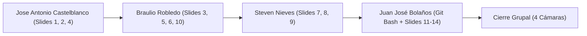

# Guion Técnico y Pauta de Grabación para Video de Sustentación Grupal
## Proyecto: Protección de Logs Estructurados en Reposo (Taller 2 – Criptografía)

> **Documento Maestro de Coordinación Audiovisual (Entregable 3)**  
> **Duración estimada:** 10 – 12 minutos  
> **Plataforma recomendada:** Zoom, Google Meet u OBS Studio (grabación de pantalla completa con cámaras de los 4 integrantes encendidas).  
> **Requisito del curso:** Participación verbal y visual equitativa de los 4 integrantes.

---

## ⚠️ AVISO OBLIGATORIO DE TERMINAL PARA EL EQUIPO

> [!IMPORTANT]
> **ENTORNO DE EJECUCIÓN (TERMINAL):**  
> * **En Linux / macOS:** Usar la terminal nativa del sistema (`bash` o `zsh`).  
> * **En Windows:** **ES ESTRICTAMENTE OBLIGATORIO USAR GIT BASH** (o WSL2).  
>   * **NO usar PowerShell ni CMD:** Comandos como `stat -c`, `sed -i`, `sha256sum`, scripts de Python para *bit-flipping* y pipes POSIX fallan o se comportan diferente en PowerShell.  
> * **Preparación:** Abrir Git Bash en la raíz del repositorio (`cd /ruta/cripto-ciber`) con fuente grande y legible (mínimo 16px).

## 📋 Checklist Rápido Pre-Grabación para el Equipo

- [ ] **Terminal:** Git Bash (Windows) o Bash (Linux) abierto en `/home/.../cripto-ciber`.
- [ ] **Limpieza de arranque:** Ejecutar `rm -rf output/*` antes de presionar grabar.
- [ ] **Prueba de comandos en terminal de respaldo:** Verificar que `go test -v ./...` pase en verde.
- [ ] **Resolución de pantalla:** Presentación en pantalla completa (F11 en navegador sobre `docs/index.html` o visor de PDF sobre `docs/presentacion_taller2.pdf`).
- [ ] **Cámaras:** Las 4 cámaras web activas y visibles en el layout de grabación durante todo el video.

---

## 👥 Tabla de Roles y Cronograma de Intervención

| Integrante / Asignación | Diapositivas | Enfoque Temático | Momento de Terminal | Duración |
| :--- | :---: | :--- | :---: | :---: |
| **Jose Antonio Castelblanco**<br>*(Dev 1 / Integrante 1: Modelado de Dominio & Generador Estocástico)* | **Slides 1, 2, 4** | Portada, vector de amenaza en reposo, permisos `0700`/`0600`, esquema JSON y `math/rand/v2`. | Diapositivas | 02:15 min |
| **Braulio Robledo**<br>*(Dev 2 / Integrante 2: Integridad, Hashing SHA-256 & Auditoría Dual)* | **Slides 3, 5, 6, 10** | Matriz STRIDE, anti-circularidad (RFC 8785), SHA-256 nativo, streaming `O(1)` y `subtle.ConstantTimeCompare`. | Diapositivas | 02:45 min |
| **Steven Nieves**<br>*(Dev 3 / Integrante 3: Cifrado AES-256-GCM & Gestión de Secretos)* | **Slides 7, 8, 9** | AES-256-GCM (AEAD), Tag GMAC, CSPRNG, permisos POSIX, diagramas de arquitectura y comportamiento. | Diapositivas | 02:15 min |
| **Juan José Bolaños**<br>*(Dev 4 / Integrante 4: Orquestación Pipeline, CLI & Tampering Tests)* | **Slides 11, 12, 13, 14** | Demostración en vivo de CLI, pruebas de tampering/bit-flipping, declaración de IA y conclusiones. | **TERMINAL EN VIVO (Git Bash)** | 03:45 min |

---

## 🎬 Guion Detallado Escena por Escena



---

### BLOQUE 1: Apertura, Amenazas y Modelado de Datos (00:00 – 02:15)
* **Voz y Cámara:** **Jose Antonio Castelblanco (Dev 1: Modelado de Dominio & Generador Estocástico)**
* **Pantalla compartida:** Presentación de Diapositivas en Pantalla Completa.

#### [00:00 - 00:30] Diapositiva 1: Portada Institucional y Ficha Técnica
* **En pantalla:** `Slide 1`
* **Guion Jose Antonio Castelblanco:**
  > *"Cordial saludo, profesor y compañeros. Somos el equipo de trabajo conformado por Jose Antonio Castelblanco, Braulio Robledo, Steven Nieves y Juan José Bolaños. Presentamos la sustentación del Taller 2 de Criptografía: Protección Criptográfica de Logs Estructurados en Reposo.*  
  > *Nuestra solución fue desarrollada en Go, empleando exclusivamente la biblioteca estándar para todas las primitivas criptográficas y de sistema."*

#### [00:30 - 01:15] Diapositiva 2: Vector de Amenaza en Reposo y Permisos POSIX
* **Acción:** Pasar a `Slide 2`.
* **En pantalla:** `Slide 2`
* **Guion Jose Antonio Castelblanco:**
  > *"En los sistemas de gestión académica, los registros y modificaciones de notas son información crítica. Si estos datos reposan en texto claro en el disco del servidor, cualquier atacante o usuario interno con privilegios puede alterar una nota sin dejar rastro.*  
  > *Para mitigar esto, aplicamos el principio de defensa en profundidad. Primero, a nivel del sistema operativo, aislamos la carpeta del proceso en permisos `0700`, que en notación octal significa `drwx------`: únicamente el usuario dueño tiene permisos de lectura (`r`), escritura (`w`) y navegación (`x`), dejando en cero al grupo y al resto del sistema. Asimismo, los archivos de secretos y logs cifrados se generan en `0600`, es decir, `-rw-------`: lectura y escritura exclusivas del dueño, sin permisos de ejecución ni acceso público."*

#### [01:15 - 02:15] Diapositiva 4: Estructura del Log JSON y Generación Estocástica
* **Acción:** Pasar a `Slide 4`.
* **En pantalla:** `Slide 4`
* **Guion Jose Antonio Castelblanco:**
  > *"Para modelar las transacciones académicas (Paso 2), estructuramos un esquema JSON con dos tipos de eventos: `REGISTRO_NOTA` y `MODIFICACION_NOTA`. Empleamos identificadores opacos sintéticos como `USR-STU` para estudiantes y `USR-DOC` para profesores.*  
  > *Las calificaciones se generan mediante una distribución uniforme en el rango de 0.0 a 5.0 utilizando `math/rand/v2`. Es clave aclarar que `math/rand/v2` es un generador pseudoaleatorio de dominio para modelar datos de negocio, totalmente diferenciado del generador criptográfico que usamos para las llaves. En las modificaciones, registramos la nota previa, la nueva y el motivo administrativo para garantizar trazabilidad. Le doy paso a mi compañero Braulio para explicar cómo blindamos la integridad de este log."*

---

### BLOQUE 2: Hashing, No-Circularidad y Auditoría Forense (02:15 – 05:00)
* **Voz y Cámara:** **Braulio Robledo (Dev 2: Integridad, Hashing SHA-256 & Auditoría Dual)**
* **Pantalla compartida:** Presentación de Diapositivas en Pantalla Completa.

#### [02:15 - 02:50] Diapositiva 3: Atributos de Calidad y Modelo STRIDE
* **Acción:** Pasar a `Slide 3`.
* **En pantalla:** `Slide 3`
* **Guion Braulio Robledo:**
  > *"Gracias, Jose. Evaluamos la solución bajo el modelo de amenazas STRIDE. Frente a la exfiltración de notas aplicamos confidencialidad con AES-256-GCM; frente al fraude quirúrgico implementamos integridad granular registro a registro; ante el borrado o reordenamiento del archivo implementamos integridad global mediante streaming O(1); y frente a ataques de canal lateral implementamos comparación en tiempo constante."*

#### [02:50 - 03:45] Diapositiva 5: Resolución de Circularidad en Hashing (Paso 3)
* **Acción:** Pasar a `Slide 5`.
* **En pantalla:** `Slide 5`
* **Guion Braulio Robledo:**
  > *"El Paso 3 presentaba un reto matemático: la paradoja de autorreferencia. Si intentamos calcular el hash de un registro que contiene dentro de sí mismo el campo del hash, la fórmula en pantalla ($H(E \cup \{h\}) \neq h$)  demuestra que **modificar el registro para incluir su propio hash altera los bytes que se intentan verificar, cayendo en una dependencia circular que no se puede resolver**.*  
  > *Nuestra solución arquitectónica fue desacoplar el evento en dos capas: el contenedor exterior y el sub-objeto inmutable `payload`. El hash SHA-256 se calcula exclusivamente sobre los bytes del `payload`. Para que este cálculo sea determinista en cualquier plataforma, implementamos el estándar **RFC 8785 (JSON Canonicalization Scheme)**, que fija un ordenamiento  estricto de las claves y normaliza números y espacios. Luego, el digest se inyecta en `payload_hash` en el contenedor exterior, dejando el payload 100% intacto."*

#### [03:45 - 04:20] Diapositiva 6: SHA-256 Nativo y Streaming O(1)
* **Acción:** Pasar a `Slide 6`.
* **En pantalla:** `Slide 6`
* **Guion Braulio Robledo:**
  > *"Para todos los resúmenes usamos SHA-256 bajo el estándar NIST FIPS 180-4 mediante `crypto/sha256`. Ofrece una resistencia de 2¹²⁸ operaciones contra colisiones —haciendo imposible encontrar dos archivos distintos con igual hash— y 2²⁵⁶ contra preimagen.*  
  > *Para los hashes globales de archivo (Pasos 5, 7 y 9), no precargamos el archivo en memoria. Implementamos procesamiento por bloques continuos con `io.Copy` en un buffer fijo de 32 KB. Esto garantiza una complejidad espacial constante O(1) (se dice "O de 1"), blindando al sistema contra ataques de denegación de servicio por memoria y evitando que el OOM Killer (Out-Of-Memory Killer, o «asesino de falta de memoria») del sistema operativo dé de baja el proceso ante archivos gigantes."*

#### [04:20 - 05:00] Diapositiva 10: Auditoría Forense Dual y Tiempo Constante (Paso 10)
* **Acción:** Pasar a `Slide 10`.
* **En pantalla:** `Slide 10`
* **Guion Braulio Robledo:**
  > *"En el Paso 10 ejecutamos una auditoría: a nivel macro comparamos los hashes globales del log original contra el descifrado bit a bit; y a nivel micro recalculamos el hash individual de cada payload para aislar exactamente cualquier registro manipulado.*  
  > *Críticamente, para mitigar ataques de canal lateral o Timing Attacks, no usamos el operador estándar `==` de Go —que retorna prematuramente en el primer byte desigual fugando microsegundos explotables—. Implementamos `crypto/subtle.ConstantTimeCompare` (implementado en `cripto-ciber/internal/audit/comparator.go` en la línea 27 para los hashes globales, y en `cripto-ciber/internal/audit/record_verifier.go` en la línea 94 para cada registro), el cual evalúa la totalidad de los bytes en un tiempo estrictamente invariante. Doy paso a Steven para la capa de cifrado y secretos."*

---

### BLOQUE 3: Cifrado AES-256-GCM y Arquitectura de Diseño (05:00 – 07:15)
* **Voz y Cámara:** **Steven Nieves (Dev 3: Cifrado AES-256-GCM & Gestión de Secretos)**
* **Pantalla compartida:** Presentación de Diapositivas en Pantalla Completa.

#### [05:00 - 05:50] Diapositiva 7: Cifrado en Reposo AES-256-GCM y Secretos
* **Acción:** Pasar a `Slide 7`.
* **En pantalla:** `Slide 7`
* **Guion Steven Nieves:**
  > *"Gracias, Braulio. Para garantizar confidencialidad e integridad simultánea en el almacenamiento en reposo (Paso 6), implementamos AES-256-GCM (método de cifrado simétrico que combina el estándar AES con una clave de 256 bits y el modo de operación Galois/Counter Mode (GCM). el cual No solo oculta los datos (confidencialidad), sino que también genera una etiqueta de autenticación para verificar que nadie ha alterado o manipulado el mensaje (integridad).) bajo la directriz NIST SP 800-38D. GCM es un modo AEAD (Authenticated Encryption with Associated Data) que cifra en bloque simétrico y genera en paralelo un Tag GMAC de autenticación de 128 bits.*  
  > *Cumpliendo NIST SP 800-57, generamos una llave de 256 bits y un número pseudoaleatorio fresco de 96 bits usando el generador criptográfico seguro CSPRNG `crypto/rand`, alimentado por la llamada al sistema `getrandom(2)`. Además, aplicamos separación física de privilegios: el log cifrado `academic_log.enc` y los secretos en `crypto_metadata.json` se guardan en archivos desacoplados con permisos `0600` (solo el usuario propietario tiene acceso de lectura y escritura)."*

#### [05:50 - 06:30] Diapositiva 8: Diagrama Estructural del Sistema
* **Acción:** Pasar a `Slide 8`.
* **En pantalla:** `Slide 8`
* **Guion Steven Nieves:**
  > *"Nuestra arquitectura sigue el patrón Clean Architecture desacoplada en cuatro paquetes dentro de `internal/`: el paquete `domain` define las estructuras inmutables e interfaces; `generator` implementa los catálogos y notas sintéticas; `crypto` contiene los adaptadores nativos de SHA-256 y AES-GCM (Advanced Encryption Standard in Galois/Counter Mode. modo de operación para cifradores por bloques simétricos que ofrece cifrado autenticado con datos asociados); y `storage` gestiona la persistencia segura y permisos POSIX. La CLI y el orquestador interactúan exclusivamente a través de interfaces sin dependencias acopladas."*

#### [06:30 - 07:15] Diapositiva 9: Comportamiento Secuencial del Pipeline
* **Acción:** Pasar a `Slide 9`.
* **En pantalla:** `Slide 9`
* **Guion Steven Nieves:**
  > *"En este diagrama de secuencia observamos la ejecución estricta de los 10 pasos del taller: desde la ingesta del volumen $N$, la inyección de hashes sin circularidad, el cálculo del hash original en P5, el cifrado AEAD en P6, hasta el descifrado autenticado en P8 y la auditoría final en P10.*  
  > *A continuación, mi compañero Juan José ejecutará la herramienta en vivo desde la terminal para evidenciar estos 10 pasos en tiempo real."*

---

### BLOQUE 4: Demostración en Terminal, Pruebas de Tampering, IA y Cierre (07:15 – 11:00)
* **Voz y Cámara:** **Juan José Bolaños (Dev 4: Orquestación Pipeline, CLI & Tampering Tests)**
* **Acción Audiovisual:** **CAMBIAR A VENTANA DE TERMINAL (Git Bash en Windows / Bash en Linux)**.

---

#### [07:15 - 08:30] DEMOSTRACIÓN 1 EN VIVO: Flujo Completo de la CLI
* **En pantalla:** **Ventana de Terminal (Git Bash)** en primer plano con tamaño de letra 18px.
* **Juan José Bolaños comparte pantalla de terminal y dice:**
  > *"Gracias, Steven. Me encuentro en la raíz del repositorio. Procedo a limpiar el directorio de salida y ejecutar el pipeline completo en modo automatizado para 25 eventos:"*

* **Comando que Juan José Bolaños ejecuta en la terminal:**
  ```bash
  rm -rf output/* && go run ./cmd/cli --auto -n 25
  ```

* **Guion Juan José Bolaños (mientras observa la salida de la terminal):**
  > *(Señalando en consola)* *"Observen cómo la CLI imprime la secuencia explicable de los 10 pasos: configuración del lote, generación estocástica de notas, sellado canónico de payloads RFC 8785, guardado del archivo plano, cómputo del hash original con streaming O(1), cifrado AES-256-GCM con tag de 128 bits, descifrado autenticado y auditoría pericial.*  
  > *Miren la tabla comparativa: el Hash del Log Original (Paso 5) y el Hash del Log Descifrado (Paso 9) son idénticos bit a bit. En cambio, el Hash del archivo cifrado (Paso 7) es completamente diferente debido a la entropía de AES-GCM. El veredicto final se resalta en verde con éxito total (25 de 25 registros íntegros)."*

* **Juan José Bolaños verifica permisos en la terminal:**
  ```bash
  stat -c "%a %A %n" output/ output/academic_log.enc output/crypto_metadata.json
  ```
* **Juan José Bolaños explica brevemente en consola:**
  > *"Confirmamos que la carpeta se encuentra en `700` (`drwx------`) y los archivos de secretos en `600` (`-rw-------`), garantizando el aislamiento en reposo."*

---

#### [08:30 - 09:30] DEMOSTRACIÓN 2 EN VIVO: Pruebas de Resistencia a Tampering
* **En pantalla:** **Terminal Git Bash**.
* **Guion Juan José Bolaños:**
  > *"Ahora simularemos dos ataques deliberados de manipulación de datos en disco para verificar la reacción forense del sistema.*  
  > *Primer ataque: alteraremos físicamente un byte dentro del archivo cifrado en disco (ataque de Bit-Flipping en el ciphertext):"*

* **Comando que Juan José Bolaños ejecuta en terminal (Ataque Bit-Flip):**
  ```bash
  python3 -c 'b=bytearray(open("output/academic_log.enc","rb").read()); b[0x4A]^=0xFF; open("output/academic_log.enc","wb").write(b)'
  go run ./cmd/cli --auto -n 5
  ```
* **Guion Juan José Bolaños (mostrando el error en consola):**
  > *"Observen la consola: `panic: cipher: message authentication failed`. El Tag GMAC detectó la inversión de un solo bit en el archivo cifrado y abortó inmediatamente el descifrado antes de exponer texto claro adulterado en la memoria.*  
  > *Segundo ataque: restauremos una corrida limpia y alteremos deliberadamente una nota en texto claro dentro del log descifrado para probar el detector pericial:"*

* **Comandos que Juan José Bolaños ejecuta en terminal (Ataque Quirúrgico de Nota):**
  ```bash
  rm -rf output/* && go run ./cmd/cli --auto -n 10
  sed -i 's/"grade": [0-9.]*/"grade": 0.0/' output/academic_log_decrypted.json
  go run ./cmd/cli
  ```
  *(Juan José selecciona en el menú interactivo con las flechas la **Opción 6: Auditar integridad** y presiona Enter)*.

* **Guion Juan José Bolaños (mostrando la alerta roja):**
  > *"Al ejecutar el auditor, observen la alerta roja: `[ ✘ ] ALERTA DE SEGURIDAD: VIOLACIÓN DE INTEGRIDAD`. El sistema detecta que el hash global diverge y la verificación registro a registro identifica con precisión quirúrgica el evento `EVT-REG-00003` adulterado, finalizando con el código POSIX `Exit Code 1`."*

---

#### [09:30 - 10:15] Diapositiva 13: Declaración de Autoría y Uso Responsable de IA
* **Acción:** **VOLVER A COMPARTIR LA PRESENTACIÓN DE DIAPOSITIVAS** en pantalla completa.
* **En pantalla:** `Slide 13`
* **Guion Juan José Bolaños:**
  > *"En estricto cumplimiento de las directrices académicas de la Universidad del Valle y los principios de integridad profesional, declaramos de forma transparente que contamos con la asistencia técnica de Google Antigravity (Gemini 3.8 Flash/Argon 4) y Anthropic Claude Code.*  
  > *La asistencia se focalizó en tres áreas metodológicas: primero, la descomposición ágil de requerimientos en historias atómicas y sprints en ClickUp; segundo, el apoyo en la arquitectura CLI en Go con parseo estándar de banderas y lectura por bloques mediante `io.Copy` con complejidad O(1) en RAM; y tercero, el co-diseño de las primitivas AES-256-GCM y canonización RFC 8785.*  
  > *Todo el código pasó por revisión manual por pares en Pull Requests, asegurando cero dependencias externas (Zero CGO), tipado fuerte y suite de pruebas de bordes y concurrencia con `-race`. El equipo comprende integralmente cada línea, asumiendo el 100% de la autoría ética y técnica del proyecto."*

#### [10:15 - 11:00] Diapositiva 14: Conclusiones Técnicas y Cierre Grupal
* **Acción:** Pasar a `Slide 14`.
* **En pantalla:** `Slide 14`
* **Guion Juan José Bolaños:**
  > *"Como lecciones aprendidas de este taller, confirmamos que la defensa en profundidad en datos en reposo requiere la combinación simétrica de confidencialidad e integridad (AEAD) junto a un hashing granular de payload; que el streaming O(1) previene vulnerabilidades de denegación de servicio; y que la higiene criptográfica mediante `subtle.ConstantTimeCompare` es indispensable frente a canales laterales.*  
  
* **[Cierre **
  > *"Agradecemos su atención. Muchas gracias."*

---

