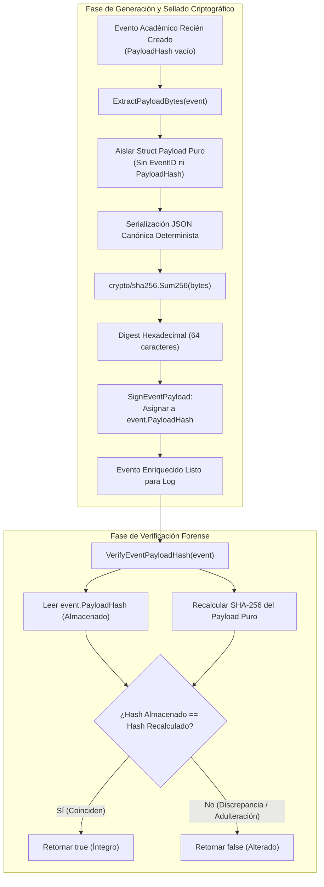

# Justificación Técnica: Selección de Campos del Payload y Desacoplamiento Criptográfico

## 1. Resumen Ejecutivo y Alcance

En la arquitectura de auditoría forense para el sistema de calificaciones, el sellado criptográfico de cada transacción académica es la garantía primaria de **integridad**, **autenticidad** y **no repudio**. El presente documento expone la justificación técnica de los campos que conforman el payload de cada evento y detalla la solución matemática y estructural implementada en Go para resolver la **dependencia circular de hashing** ($H(E)$ incrustado en $E$), así como los fundamentos de seguridad que respaldan la adopción de **SHA-256** bajo el estándar **NIST FIPS 180-4**.

---

## 2. Definición y Justificación de los Campos del Payload Transaccional

El payload de negocio constituye el núcleo inmutable de la transacción académica. A diferencia del evento contenedor (que incluye metadatos de transporte como identificadores de log o hashes de bloque), el payload contiene exclusivamente las dimensiones fácticas de la evaluación.

### 2.1 Campos Constituyentes

| Campo | Tipo | Ámbito | Descripción Técnica |
| :--- | :--- | :--- | :--- |
| `student_uid` | `string` (UUIDv4) | Registro / Modificación | Identificador sintético opaco del estudiante evaluado (Prefijo `STU-`). |
| `subject_uid` | `string` (UUIDv4) | Registro / Modificación | Identificador sintético del curso o asignatura (Prefijo `SUB-`). |
| `evaluator_uid` | `string` (UUIDv4) | Registro | Identificador del docente o evaluador que califica originalmente (Prefijo `DOC-`). |
| `modifier_uid` | `string` (UUIDv4) | Modificación | Identificador del docente o autoridad que altera la calificación (Prefijo `DOC-`). |
| `grade` | `float64` [0.0 - 5.0] | Registro | Valor numérico asignado a la evaluación. |
| `previous_grade` | `float64` [0.0 - 5.0] | Modificación | Calificación anterior inmediata sujeta a corrección. |
| `new_grade` | `float64` [0.0 - 5.0] | Modificación | Nueva calificación rectificada. |
| `reason` | `string` ($\ge 10$ chars) | Modificación | Motivo administrativo justificado del cambio de nota. |
| `evaluation` | `string` | Registro / Modificación | Denominación del hito académico (ej. "Parcial 1", "Taller 2"). |
| `timestamp` | `time.Time` (UTC) | Registro / Modificación | Marca de tiempo atómica en que ocurrió la transacción. |

---

### 2.2 Justificación de Campos para No Repudio e Inmutabilidad

Cada campo incorporado en el digest cumple una función criptográfica y forense irreemplazable:

1. **Atribución de Sujeto y Contexto (`student_uid`, `subject_uid`, `evaluation`):**
   - **Propósito:** Vinculan unívocamente la calificación a un alumno específico, en una materia determinada y bajo un hito evaluativo particular.
   - **Garantía Criptográfica:** Impiden ataques de sustitución de contexto, donde un atacante intente trasladar una calificación válida de 5.0 en un "Taller" a un "Examen Final", o de un estudiante a otro.

2. **Atribución de Autoría y No Repudio (`evaluator_uid`, `modifier_uid`):**
   - **Propósito:** Identifican formalmente al autor de la acción evaluativa.
   - **Garantía Criptográfica:** En esquemas de auditoría, el no repudio exige que el emisor de una transacción no pueda negar haberla originado. Al sellar el UID del docente dentro del hash SHA-256, cualquier intento posterior de aducir que la nota fue asignada por otro actor o por el sistema resulta matemáticamente refutable.

3. **Certeza Cuantitativa y Trazabilidad del Delta (`grade`, `previous_grade`, `new_grade`, `reason`):**
   - **Propósito:** Fijan el valor de la nota e impiden la alteración silenciosa del historial.
   - **Garantía Criptográfica:** En modificaciones, la inclusión obligatoria de `previous_grade` y `new_grade` actúa como una validación de concurrencia optimista (*Compare-And-Swap*). Congela el estado previo exacto, asegurando que nadie pueda insertar modificaciones espurias sin evidenciar una ruptura en la secuencia lógica de calificaciones. El campo `reason` certifica la causa administrativa auditada.

4. **Anclaje Temporal y Resistencia a Repetición (`timestamp`):**
   - **Propósito:** Registra el instante preciso en UTC bajo el estándar RFC 3339.
   - **Garantía Criptográfica:** Evita ataques de repetición (*replay attacks*) y desorden temporal. Dos evaluaciones con notas y actores idénticos tendrán hashes divergentes debido al timestamp, preservando la unicidad atómica de cada hito en la línea de tiempo forense.

---

## 3. El Problema de la Dependencia Circular Criptográfica y su Solución

### 3.1 Planteamiento Matemático del Problema

Sea $H: \{0,1\}^* \to \{0,1\}^{256}$ una función hash criptográfica resistente a colisiones y preimágenes (SHA-256).

Si un evento estructurado $E$ se define ingenuamente conteniendo todos sus campos más su propio digest $h$, tenemos:

$$E = \{ \text{Payload}, h \}$$

Para sellar el evento con su hash de integridad, se requeriría calcular:

$$h = H(E) = H(\{ \text{Payload}, h \})$$

Esta formulación constituye una **definición circular / autorreferencial**:
- Para calcular $h$, se necesita la representación completa en bytes de $E$.
- Pero la representación de $E$ requiere conocer previamente el valor exacto de $h$.
- Si un desarrollador calcula $h_0 = H(\{ \text{Payload}, \text{""} \})$ con el campo vacío o nulo y luego escribe $h_0$ en el evento, el nuevo estado del evento es $E' = \{ \text{Payload}, h_0 \}$.
- En el momento de la verificación, el verificador calcula:

$$H(E') = H(\{ \text{Payload}, h_0 \}) \ne h_0$$

Dado el **efecto avalancha** intrínseco de SHA-256 (donde cambiar un solo bit altera en promedio el 50% de los bits resultantes), $H(E') \ne h_0$ con probabilidad prácticamente 1 ($1 - 2^{-256}$), provocando un fallo total en la verificación de integridad.

---

### 3.2 Solución Arquitectónica: Desacoplamiento Estructural en Dos Niveles

La solución adoptada en el paquete `internal/crypto` rechaza cualquier artificio de serialización mutable sobre strings vacíos y adopta una **separación estructural estricta** en el sistema de tipos de Go:

```
┌────────────────────────────────────────────────────────┐
│ Evento Contenedor: GradeRegistrationEvent              │
│  - EventID: "EVT-REG-00001"                            │
│  - EventType: "REGISTRO_NOTA"                          │
│  - Payload: GradeRegistrationPayload ──────────────┐   │
│  - PayloadHash: "e3b0c44..." <── Asignación final  │   │
└────────────────────────────────────────────────────│───┘
                                                     ▼
┌────────────────────────────────────────────────────────┐
│ Payload Puro (Aislado de Circularidad)                │
│  - StudentUID: "STU-001"                               │
│  - SubjectUID: "SUB-001"                               │
│  - EvaluatorUID: "DOC-001"                             │
│  - Grade: 4.5                                          │
│  - Evaluation: "Parcial 1"                             │
│  - Timestamp: "2026-10-21T14:00:00Z"                   │
└────────────────────────────────────────────────────────┘
```

1. **Aislamiento Funcional (`ExtractPayloadBytes`):**
   - La función de extracción inspecciona el evento polimórfico (`GradeRegistrationEvent` o `GradeModificationEvent`) y extrae únicamente la instancia interna del struct de datos de negocio (`Payload`).
   - El contenedor exterior (`event_id`, `event_type`, `payload_hash`) se descarta completamente de la entrada del serializador.
2. **Serialización Canónica Determinista (`Canonicalize`):**
   - El payload extraído se serializa a JSON canónico determinista.
   - **Defensa en profundidad:** Se valida mediante inspección de bytes (`bytes.Contains`) que la secuencia resultante no contenga claves como `"payload_hash":`, retornando `ErrCircularMetadataDetected` si se detecta contaminación estructural.
3. **Inscripción del Digest (`SignEventPayload`):**
   - El digest $h = \text{SHA-256}(\text{CanonicalPayload})$ se calcula de forma unidireccional.
   - Una vez obtenido el hash hexadecimal inmutable de 64 caracteres, se inscribe en el campo `event.PayloadHash` del contenedor padre.
4. **Verificación Pura (`VerifyEventPayloadHash`):**
   - El verificador extrae nuevamente el payload puro, recalcula el digest y lo compara directamente con el campo `PayloadHash` guardado en el contenedor. Si el contenido fue manipulado, los hashes divergen y la función retorna `false`.

---

### 3.3 Diagrama de Flujo: Extracción, Sellado y Verificación



---

## 4. Selección del Algoritmo Criptográfico: SHA-256

Se evaluó la idoneidad técnica de los algoritmos de resumen criptográfico bajo criterios de seguridad informática contemporánea:

### 4.1 Comparativa de Seguridad y Resistencia a Colisiones

| Algoritmo | Tamaño del Bloque | Tamaño del Digest | Resistencia a Colisiones | Estado de Seguridad Criptográfica |
| :--- | :--- | :--- | :--- | :--- |
| **MD5** | 512 bits | 128 bits | **Rota** ($2^{21}$ operaciones prácticas) | **Obsoleto / Prohibido.** Vulnerable a colisiones en segundos desde 2004 (Wang et al.). |
| **SHA-1** | 512 bits | 160 bits | **Rota** ($2^{63.1}$ operaciones prácticas) | **Deprecado.** Vulnerable a colisiones prácticas demostradas (SHAttered, 2017). |
| **SHA-256** | 512 bits | **256 bits** | **Intacta** ($2^{128}$ operaciones contra cumpleaños) | **Estándar Vigente (NIST FIPS 180-4).** Sin ataques prácticos conocidos. |

### 4.2 Criterios Técnicos de Selección

1. **Margen de Seguridad contra Ataques de Cumpleaños:**
   - La seguridad de una función hash contra ataques de colisión depende de la mitad de la longitud de su digest ($n/2$). SHA-256 ofrece $2^{128}$ operaciones de complejidad temporal, lo cual es inabordable para las capacidades computacionales actuales y previsibles.
   - MD5 ($2^{64}$) y SHA-1 ($2^{80}$ teórico, $2^{63}$ real) permiten que un atacante genere dos transacciones académicas con contenidos radicalmente diferentes (ej. una nota de 1.0 y otra de 5.0) que produzcan exactamente el mismo hash, invalidando por completo la función de auditoría.

2. **Cumplimiento Estricto de Estándares Internacionales:**
   - SHA-256 forma parte de la familia SHA-2 estandarizada bajo **NIST FIPS PUB 180-4**, avalada por el consorcio **CNSA (Commercial National Security Algorithm Suite)** y requerida por marcos regulatorios financieros y gubernamentales (ISO/IEC 10118-3, PCI-DSS, HIPAA).

3. **Aceleración Nativa por Hardware (SHA-NI / ARMv8 Crypto):**
   - Los procesadores modernos x86-64 incorporan el conjunto de instrucciones **Intel SHA Extensions (SHA-NI)** (`SHA256MSG1`, `SHA256MSG2`, `SHA256RNDS2`), y la arquitectura ARMv8 implementa extensiones criptográficas de hardware específicas.
   - En Go, la biblioteca nativa estándar `crypto/sha256` detecta estas instrucciones en tiempo de ejecución de forma transparente, alcanzando velocidades de procesamiento del orden de gigabytes por segundo con consumo de CPU despreciable.

4. **Uso Exclusivo de Biblioteca Estándar Nativa:**
   - Al emplear directamente `crypto/sha256` y `encoding/hex` de la distribución nativa de Go (sin paquetes externos como `golang.org/x/crypto`), se elimina la superficie de ataque por cadena de suministro (*supply-chain attack*) y se garantiza compatibilidad sin dependencias adicionales.

---

## 5. Matriz Resumen para Sustentación y Diapositivas

| Dimensión | Decisión de Ingeniería | Justificación de Seguridad |
| :--- | :--- | :--- |
| **Composición del Payload** | 10 campos estrictamente transaccionales | Cobertura total de sujeto, evaluador, materia, notas (previa/nueva), motivo y tiempo UTC. |
| **No Repudio** | Inclusión de `evaluator_uid` y `modifier_uid` | Atribución matemática irrefutable del autor de cada calificación o cambio. |
| **Anti-Replay** | Timestamp UTC en RFC 3339 | Diferenciación cronológica obligatoria aun entre calificaciones idénticas. |
| **Circularidad** | Desacoplamiento en 2 niveles (Contenedor vs Payload) | Elimina la dependencia recursiva $H(\{P, h\})$ garantizando determinismo estricto. |
| **Defensa en Profundidad** | Filtro `bytes.Contains` para `"payload_hash":` | Verificación en tiempo de ejecución contra fugas accidentales de metadatos del contenedor. |
| **Algoritmo de Hashing** | SHA-256 nativo (`crypto/sha256`) | Resistencia comprobada a colisiones (256 bits), estándar NIST FIPS 180-4 y aceleración por hardware. |
