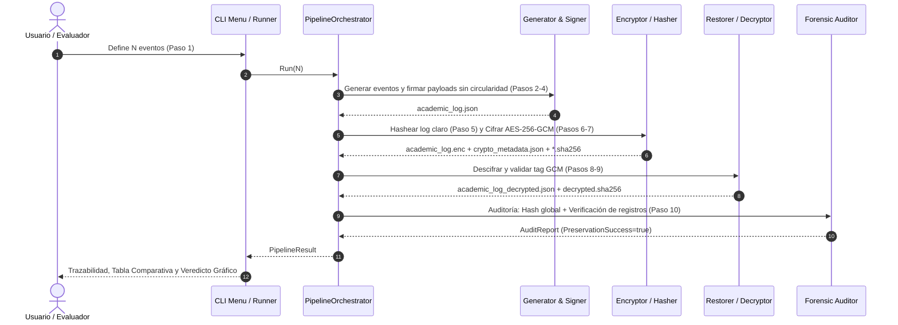

# Estructura y Contenido de Diapositivas para Sustentación
## Proyecto: Protección de Logs Estructurados en Reposo (Taller 2 – Criptografía)

> **Documento de Diseño y Contenido para Diapositivas (Entregable 2 - PDF)**  
> **Formato de exportación sugerido:** Presentación 16:9 (Canva / PowerPoint / Google Slides) exportada a `.PDF`.

---

## Índice General de Diapositivas

1. **Slide 1:** Portada Institucional y Ficha Técnica
2. **Slide 2:** Planteamiento del Problema y Contexto de Negocio
3. **Slide 3:** Atributos de Seguridad y Modelo de Amenazas
4. **Slide 4:** Arquitectura del Log y Esquema Estructurado JSON
5. **Slide 5:** Desacoplamiento Criptográfico y Prevención de Circularidad (Paso 3)
6. **Slide 6:** Primitivas Criptográficas: SHA-256 Nativo y Streaming O(1)
7. **Slide 7:** Cifrado en Reposo: AES-256-GCM y Gestión de Llaves (NIST SP 800-38D / 800-57)
8. **Slide 8:** Diagrama de Diseño 1: Arquitectura Estructural del Sistema
9. **Slide 9:** Diagrama de Diseño 2: Comportamiento Secuencial del Pipeline (Pasos 1 al 10)
10. **Slide 10:** Auditoría Forense y Comparación en Tiempo Constante (Paso 10)
11. **Slide 11:** Demostración Práctica: Trazabilidad y Resultados en Consola
12. **Slide 12:** Demostración Práctica: Prueba de Tampering y Resistencia Forense
13. **Slide 13:** Declaración Obligatoria de Uso Responsable de IA
14. **Slide 14:** Conclusiones y Cumplimiento de Objetivos del Taller

---

## Detalle Diapositiva por Diapositiva

### Slide 1: Portada Institucional y Ficha Técnica
- **Encabezado:** Universidad del Valle – Facultad de Ingeniería – Escuela de Ingeniería de Sistemas y Computación
- **Título:** CLI Segura: Protección Criptográfica de Logs en Reposo
- **Subtítulo:** Criptografía Simétrica, Hashing Forense y Auditoría Atómica (Taller 2)
- **Integrantes:**
  - *Jose Antonio Castelblanco* (Rol: Modelado de Dominio y Generador Estocástico)
  - *Braulio Robledo* (Rol: Integridad, Hashing SHA-256 y Auditoría Dual)
  - *Steven Nieves* (Rol: Cifrado AES-256-GCM y Gestión de Secretos)
  - *Juan José Bolaños* (Rol: Orquestación Pipeline, CLI y Pruebas de Tampering)
- **Badges y Estándares:** Go 1.22+ • RFC 8785 • Zero CGO • NIST FIPS 180-4 • NIST SP 800-38D.
- **Video de Sustentación (YouTube):** [https://www.youtube.com/watch?v=noc2NYgj0c0](https://www.youtube.com/watch?v=noc2NYgj0c0)
- **Comando en Pantalla:**
  ```bash
  $ go run ./cmd/cli --auto -n 25
  ```

---

### Slide 2: Planteamiento del Problema y Contexto de Amenaza
- **Título:** Vector de Amenaza: Manipulación en Reposo (Data at Rest)
- **Puntos Clave (Escaneabilidad Video):**
  - **Sensibilidad:** Alteración de notas altera actas oficiales, becas y títulos.
  - **Fraude Quirúrgico:** Variar una décima (4.4 a 4.5) es indetectable en texto claro sin firmas.
  - **Superficie de Exposición:** Adversarios internos (DBAs/root) o atacantes con acceso al host.
  - **Carpeta 0700:** `drwx------` (0700: lectura, escritura y acceso únicamente al usuario propietario del directorio).
  - **Secretos 0600:** `-rw-------` (0600: lectura y escritura únicamente al usuario propietario del archivo).
- **Comando de Exposición en Claro vs Mitigación:**
  ```bash
  # Ataque en texto claro
  $ cat output/academic_log.json | grep "grade"
  $ sed -i 's/"grade": 4.5/"grade": 5.0/' output/academic_log.json

  # Mitigación: Blindaje AES-256-GCM y permisos POSIX octales (Dueño | Grupo | Otros)
  $ stat -c "%a %A %n" output/ output/academic_log.enc
  700 drwx------ output/ (rwx=4+2+1 solo dueño)
  600 -rw------- output/academic_log.enc (rw=4+2 solo dueño)
  ```

---

### Slide 3: Atributos de Seguridad y Matriz STRIDE
- **Título:** Atributos de Calidad & Modelo de Mitigación
- **Matriz de Seguridad:**
  | Atributo | Mecanismo Implementado en Go | Amenaza Mitigada (STRIDE) |
  | :--- | :--- | :--- |
  | **Confidencialidad** | AES-256-GCM (cifrado AEAD en reposo) | Exfiltración no autorizada de calificaciones |
  | **Integridad Granular** | SHA-256 canónico en sub-payload | Mutación quirúrgica de notas o UIDs |
  | **Integridad Global** | SHA-256 Streaming O(1) en archivo | Inserción, borrado o reorden de eventos |
  | **Autenticidad** | Tag GMAC (firma de autenticación 128-bit) | Inyección de ciphertext forjado o bit-flipping |
  | **Inmunidad Timing** | `crypto/subtle.ConstantTimeCompare` (tiempo constante) | Ataques de canal lateral por microsegundos |
- **Comando de Validación:**
  ```bash
  $ go test -v -run "TestCrypto|TestAudit" ./...
  PASS: TestAESGCM_BitFlippingDetection (0.01s)
  PASS: TestConstantTimeCompare_TimingInvariant (0.00s)
  ```

---

### Slide 4: Arquitectura del Log y Esquema JSON
- **Título:** Estructura del Log: `academic_log.json`
- **Contenido:**
  - Identificadores sintéticos opacos: `USR-STU-*`, `USR-DOC-*`, `SUB-*`.
  - Generación estocástica uniforme `U[0.0, 5.0]` (`math/rand/v2`: PRNG de dominio, no criptográfico).
  - Trazabilidad de deltas: `previous_grade`, `new_grade` y `reason`.
- **Comando de Inspección en Consola:**
  ```bash
  $ jq '.[0] | {event_id, payload_hash}' output/academic_log.json
  ```
- **Anatomía del Registro (Sellado de Payload):**
  - Evento `REGISTRO_NOTA`: Sella exclusivamente el sub-objeto `payload`.
  - Evento `MODIFICACION_NOTA`: Historial inmutable de rectificaciones.

---

### Slide 5: Desacoplamiento Criptográfico (Paso 3)
- **Título:** Resolución de Circularidad en Hashing de Payload
- **La Paradoja de Autorreferencia:**
  - `H(E ∪ {h}) ≠ h`: Autosellar un objeto que incluye su propio digest genera recursión infinita.
- **Pipeline de Aislamiento en 4 Pasos:**
  1. *Aislamiento:* Bifurcación en contenedor exterior y sub-objeto `payload`.
  2. *Canonicidad:* RFC 8785 determinista en UTF-8 lexicográfico.
  3. *Cálculo:* SHA-256 aplicado estrictamente sobre los bytes del payload.
  4. *Inyección:* El digest se inyecta en `payload_hash` sin mutar el payload.
- **Ecuación Formal:**
  $$\text{PayloadHash} = \text{SHA256}(\text{CanonicalJSON}(\text{Event}.\text{Payload}))$$
- **Comando de Verificación Unitario:**
  ```bash
  $ go test -v -run TestCanonicalPayloadHash ./...
  PASS: TestCanonicalPayloadHash_NoCircularity (0.00s)
  ```

---

### Slide 6: Primitivas Criptográficas: SHA-256 y Streaming O(1)
- **Título:** SHA-256 Nativo y Procesamiento por Streaming `O(1)`
- **Puntos Clave:**
  - NIST FIPS 180-4: Espacio de 2¹²⁸ operaciones para colisión; 2²⁵⁶ para preimagen.
  - Aceleración hardware nativa (Intel SHA-NI / ARMv8 Crypto Extensions).
  - Streaming `O(1)` RAM: `io.Copy(hasher, file)` sin cargar archivos gigantescos en RAM (inmunidad contra OOM Killer).
- **Interoperabilidad Forense Universal (POSIX Coreutils):**
  ```bash
  $ sha256sum -c output/academic_log.json.sha256
  output/academic_log.json: OK
  $ sha256sum -c output/academic_log.enc.sha256
  output/academic_log.enc: OK
  ```

---

### Slide 7: Cifrado en Reposo: AES-256-GCM y Gestión de Llaves
- **Título:** Cifrado Autenticado en Reposo: AES-256-GCM
- **Selección AEAD (NIST SP 800-38D):**
  - Cifrado en flujo AES-CTR con bloque de 128 bits y llave robusta de 256 bits.
  - Tag GMAC de 128 bits calculado en paralelo.
  - Mitigación de bit-flipping: Mutar 1 solo bit aborta el descifrado (`cipher: message authentication failed`).
- **Gestión de Secretos (NIST SP 800-57):**
  - Clave 256 bits + Nonce 96 bits vía CSPRNG `crypto/rand` (`getrandom(2)`).
  - Desacoplamiento físico: `academic_log.enc` separado de `crypto_metadata.json` (permisos `0600 (lectura y escritura únicamente al usuario propietario del archivo)`).
- **Comando de Verificación (Permisos Octales y Modo Simbólico):**
  ```bash
  $ stat -c "%a %A %n" output/academic_log.enc output/crypto_metadata.json
  600 -rw------- output/academic_log.enc
  600 -rw------- output/crypto_metadata.json
  ```

---

### Slide 8: Diagrama de Diseño 1: Arquitectura Estructural
- **Título:** Diagrama de Diseño 1: Arquitectura y Desacoplamiento de Paquetes
- **Artefactos del Entregable:**
  - Código fuente Mermaid: `docs/diagramas/diagrama_estructural.mmd`
  - Renderizado HD: `docs/diagramas/diagrama_estructural.png` (y versión vectorial `docs/diagramas/diagrama_estructural.svg`)
- **Diagrama Mermaid (Estructura de Componentes):**
```mermaid
graph TD
    CLI["cmd/cli (UI / Menú interactivo Survey / Views)"] --> ORCH["internal/pipeline (PipelineOrchestrator)"]
    ORCH --> GEN["internal/generator (Modelos y Distribución)"]
    ORCH --> CRYPTO["internal/crypto (SHA-256 & AES-256-GCM)"]
    ORCH --> STORAGE["internal/storage (Logs, Metadata y Paths)"]
    ORCH --> AUDIT["internal/audit (Comparador y Verificador)"]
    
    subgraph Dominio & Criptografía Nativa
        GEN --> DOMAIN["internal/domain"]
        CRYPTO --> DOMAIN
        AUDIT --> DOMAIN
        CRYPTO -.-> GOLIB["Go Standard Library: crypto/*"]
    end

    subgraph Persistencia Desacoplada (output/)
        STORAGE -.-> F1["academic_log.json (Texto Claro)"]
        STORAGE -.-> F2["academic_log.enc (Ciphertext GCM)"]
        STORAGE -.-> F3["crypto_metadata.json (Key/Nonce)"]
        STORAGE -.-> F4["*.sha256 (Testigos Coreutils)"]
        STORAGE -.-> F5["academic_log_decrypted.json (Recuperado)"]
    end
```
- **Puntos a destacar:** Separación estricta de responsabilidades, ausencia de ciclos de dependencia, interfaces desacopladas (`GradeGenerator`, `SymmetricEncryptor`, `SymmetricDecryptor`), aislamiento cripto/almacenamiento en reposo y cero librerías criptográficas de terceros.

---

### Slide 9: Diagrama de Diseño 2: Comportamiento Secuencial
- **Título:** Diagrama de Diseño 2: Ciclo de Vida Criptográfico (Pasos 1 al 10)
- **Artefactos del Entregable:**
  - Código fuente Mermaid: `docs/diagramas/diagrama_comportamiento.mmd`
  - Renderizado HD: `docs/diagramas/diagrama_comportamiento.png` (y versión vectorial `docs/diagramas/diagrama_comportamiento.svg`)
- **Diagrama Mermaid (Flujo Temporal):**

- **Puntos a destacar:** Cobertura secuencial estricta de los 10 pasos, aislamiento de payload para evitar dependencias circulares, material criptográfico fresco (CSPRNG), verificación atómica del Auth Tag de AES-GCM y mitigación de timing attacks (`subtle.ConstantTimeCompare`).

---

### Slide 10: Auditoría Forense y Comparación en Tiempo Constante (Paso 10)
- **Título:** Auditoría Forense Dual & Constant-Time Compare
- **Doble Nivel de Verificación:**
  1. **Nivel Macroscópico (Global):**
     - Comparación de `academic_log.json.sha256` contra `academic_log_decrypted.sha256` (integridad bit a bit).
  2. **Nivel Microscópico (Granular por Registro):**
     - `VerifyAllRecords()` recalcula el digest de cada payload individual contra su `payload_hash`.
     - Identifica quirúrgicamente el UID del alumno y el evento manipulado.
- **Mitigación de Timing Attacks (Canales Laterales):**
  ```go
  // Comparación en tiempo constante invariante O(N)
  if subtle.ConstantTimeCompare([]byte(origHash), []byte(decHash)) == 1 { ... }
  ```
- **Comando en Terminal:**
  ```bash
  $ go run ./cmd/cli # Opción 6: Auditoría
  ```

---

### Slide 11: Demostración Práctica: Trazabilidad y Hashes
- **Título:** Resultados en Consola & Trazabilidad de Hashes
- **Comando de Ejecución:**
  ```bash
  $ go run ./cmd/cli --auto -n 25
  ```
- **Cadena Forense de Custodia (SHA-256):**
  | Etapa de Pipeline | Resumen Criptográfico (SHA-256) |
  | :--- | :--- |
  | **1. Log Original (P5)** | `416d902757ac1321...` |
  | **2. Log Cifrado (P7)** | `a4762936283f3d1a...` (Divergencia total) |
  | **3. Log Descifrado (P9)** | `416d902757ac1321...` (**100% Match**) |
- **Veredicto Forense:** `[ ✔ ] VERIFICACIÓN EXITOSA: INTEGRIDAD Y CONFIDENCIALIDAD PRESERVADAS` (25/25 válidos).

---

### Slide 12: Demostración Práctica: Pruebas de Tampering
- **Título:** Pruebas de Robustez y Detección de Tampering
- **Escenario 1: Corrupción en Reposo (Bit-Flipping en Ciphertext):**
  ```bash
  $ python3 -c 'b=bytearray(open("output/academic_log.enc","rb").read()); b[0x4A]^=0xFF; open("output/academic_log.enc","wb").write(b)'
  $ go run ./cmd/cli # Opción 5: Descifrar y validar integridad
  # Resultado: ✖ failed to decrypt log file: ... cipher authentication tag mismatch: data tampered or corrupted
  ```
- **Escenario 2: Adulteración en Claro (Manipulación Selectiva de Nota):**
  ```bash
  $ sed -i 's/"grade": [0-9.]*/"grade": 0.0/' output/academic_log_decrypted.json
  $ go run ./cmd/cli # Opción 6: Auditoría
  # Resultado: [✘] EVT-REG-00003: Payload Hash Discrepancy!
  ```
- **Alerta Forense:** `[ ✘ ] ALERTA DE SEGURIDAD: VIOLACIÓN DE INTEGRIDAD DETECTADA`.
- **Códigos de Salida POSIX:** `Exit Code 0` (Éxito), `Exit Code 1` (Tampering / Discrepancia), `Exit Code 2` (Error de CLI).

---

### Slide 13: Declaración de Autoría y Uso Responsable de IA
- **Título:** Declaración de Autoría y Uso Responsable de Inteligencia Artificial
- **Metodología y Áreas de Asistencia:**
  - *Herramientas:* Google Antigravity (Gemini 3.8 Flash/Argon 4) y Anthropic Claude Code, bajo estricto marco de supervisión humana. Se realizaron las diapositivas con ayuda de la skill "https://github.com/nugrahalabib/AgentBuff-Presentation-Skills".
  - *1. Gestión & ClickUp:* Descomposición de requerimientos de seguridad en historias atómicas (US-1 a US-11), criterios de aceptación y sprints.
  - *2. Arquitectura CLI & Streaming:* Parseo de parámetros (`--auto`, `-n`) con la biblioteca estándar de Go y lectura por bloques mediante `io.Copy` para procesar archivos de cualquier tamaño con memoria constante `O(1)` sin riesgo de saturar la RAM.
  - *3. Criptografía Nativa:* Co-diseño de AES-256-GCM, derivación segura de llaves, canonización RFC 8785 y desacoplamiento para resolver la circularidad del hash.
- **Gobernanza, Auditoría y Responsabilidad Ética:**
  - *Code Review Manual en PRs:* Revisión por pares obligatoria antes de integrar cambios a `main`, descartando librerías externas y blindando contra canales laterales con `subtle.ConstantTimeCompare`.
  - *Verificación Empírica & Tests:* Suite exhaustiva de table-driven tests (concurrencia con `-race`, bit-flipping, corrupción de tags GMAC y permisos POSIX `0600 (lectura y escritura únicamente al usuario propietario del archivo)`).
  - *Autoría Total & Comprensión:* El equipo comprende exhaustivamente la arquitectura interna, el flujo de memoria y la criptografía aplicada, asumiendo total autoría ética y técnica del software entregado.
- **Comando de Validación:**
  ```bash
  $ go test -v -race ./...
  # PASS: 30+ tests unitarios, concurrencia y tampering (100% OK, Cobertura 100%)
  ```

---

### Slide 14: Conclusiones Técnicas y Defensa en Profundidad
- **Título:** Conclusiones Técnicas y Defensa en Profundidad
- **Lecciones de Seguridad:**
  - *Defensa en Profundidad:* AEAD (AES-256-GCM) + Hashing granular previene manipulación en reposo.
  - *Rendimiento Nativo:* Cero dependencias externas y complejidad `O(1)` en memoria RAM eliminan riesgos de cadena de suministro y DoS.
  - *Higiene Criptográfica:* `subtle.ConstantTimeCompare` es mandatorio frente a canales laterales.
  - *Aislamiento POSIX:* Directorio `0700` y secretos `0600` blindan los activos en el sistema operativo.
- **Comando de Validación:**
  ```bash
  $ go test -v -race ./...
  ```
- **Video de Sustentación (YouTube):** [https://www.youtube.com/watch?v=noc2NYgj0c0](https://www.youtube.com/watch?v=noc2NYgj0c0)
